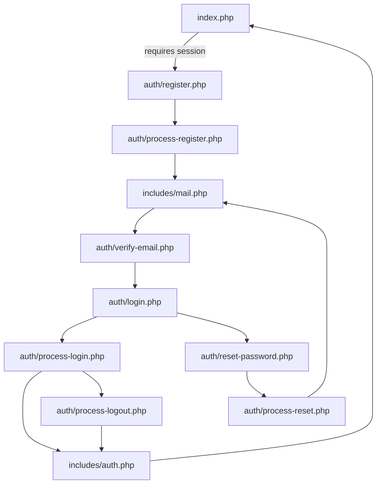

# Login Module

This project is a small PHP/MySQL authentication module with three connected forms:

- registration
- login
- password reset

The user can move between the pages through the UI links, and each form has both client-side and server-side validation.

## Project Structure

- `index.php` - protected landing page shown after login
- `start-dev.sh` - local development helper that starts the app and MailHog together
- `test-db.php` - quick database connection check script
- `scripts/cleanup-expired-tokens.php` - CLI maintenance script that purges expired or used token rows
- `db_diagram.pdf` - database diagram reference
- `auth/login.php` - login form
- `auth/register.php` - registration form
- `auth/reset-password.php` - password reset form
- `auth/process-login.php` - login handler
- `auth/process-register.php` - registration handler
- `auth/process-reset.php` - password reset handler
- `auth/verify-email.php` - email verification handler
- `assets/css/navbar.css` - styling for the dashboard navigation bar
- `assets/css/page-transition.css` - page transition styles
- `assets/css/startup-overlay.css` - startup overlay styles
- `assets/css/style.css` - shared styling for all forms
- `assets/js/index.js` - shared form validation and result banner behavior
- `assets/js/mobile-nav.js` - mobile navigation drawer behavior
- `assets/js/profile-modal.js` - profile modal behavior and country loading
- `assets/js/startup-overlay.js` - startup overlay interaction logic
- `database/schema.sql` - database schema
- `includes/mail.php` - SMTP helper for outgoing emails
- `includes/auth.php` - session, CSRF, and auth helpers
- `includes/db.php` - database connection
- `includes/config.example.php` - configuration template
- `includes/config.php` - local configuration file

## Database Setup

Use `database/schema.sql` to create the MySQL schema.

The schema includes the tables for users, password resets, and email verification tokens.

Import steps:

1. Open MySQL Workbench.
2. Connect to your server.
3. Open `database/schema.sql`.
4. Run the script.

## Configuration

Copy `includes/config.example.php` to `includes/config.php` and set your local database and application values there.

The real `config.php` file is ignored by Git and should remain local.

## Application Flow

This project follows a simple end-to-end authentication flow where each page and handler has a clear role.

1. **Initial access**
   - `index.php` is the protected landing page.
   - It requires a valid session and redirects anonymous users to `auth/register.php`.

2. **Registration**
   - `auth/register.php` shows the registration form.
   - Client-side validation is handled by `assets/js/index.js`.
   - On submit, the form posts to `auth/process-register.php`.
   - The handler validates the data again on the server, checks for duplicates, hashes the password, creates the user, and generates an email verification token.
   - `includes/mail.php` sends the verification email.
   - The new account remains inactive until the verification link is opened.

3. **Email verification**
   - `auth/verify-email.php` receives the token from the email link.
   - It checks that the token is valid, unused, and not expired.
   - If everything is correct, the user account is activated and the verification token is marked as used.

4. **Login**
   - `auth/login.php` shows the login form and user feedback messages.
   - The form submits to `auth/process-login.php`.
   - The handler checks CSRF, loads the user from the database, verifies the password, handles failed login attempts, and creates the session.
   - If the `Remember me` option is selected, `includes/auth.php` issues a persistent token and restores the session on later visits.

5. **Password reset**
   - `auth/reset-password.php` shows two different states:
     - the reset request form, if no token is present;
     - the new password form, if a reset token is present.
   - The form submits to `auth/process-reset.php`.
   - The handler either sends a reset email or completes the password update, depending on the submitted data.
   - Reset tokens are time-limited and can be used only once.

6. **Logout**
   - `auth/process-logout.php` validates the request, clears the session, removes remember-me data, and redirects the user back to the public area.

7. **Shared support files**
   - `includes/auth.php` provides session handling, CSRF helpers, remember-me management, and logout utilities.
   - `includes/db.php` creates the database connection used by all handlers.
   - `includes/mail.php` sends verification and reset emails.

## Authentication Flow

The forms and handlers are connected through the application flow described above:

- `register.php` lets a new user create an account.
- `login.php` lets an existing user sign in.
- `reset-password.php` lets a user request a reset email and set a new password.
- New accounts must verify their email address before they can log in.

The root page `index.php` is protected and redirects unauthenticated users to the registration page.

## Request Flow Diagram

The diagram below gives a quick visual summary of how requests move through the project.



The diagram shows the main request lifecycle at a glance:

- `includes/db.php` provides the shared database connection used by the handlers.
- `includes/auth.php` manages sessions, CSRF protection, remember-me tokens, and logout helpers.
- `includes/mail.php` sends verification and reset emails.

## Form Validations

### Register

Client-side and server-side checks are applied to:

- username is required
- username must be at least 6 characters
- username can contain only letters, numbers, and underscores
- email is required
- email must have a valid format
- password is required
- password must be at least 8 characters
- password must include at least one uppercase letter, one lowercase letter, one number, and one symbol
- confirm password is required
- confirm password must match password

### Login

Client-side and server-side checks are applied to:

- username or email is required
- password is required
- account status is checked on the server
- unverified accounts are rejected until the verification link is used
- invalid credentials are rejected
- repeated failed attempts can temporarily lock the account

The login form also supports persistent login with a `Remember me` checkbox:

- stores a secure selector/validator token pair in `remember_me_tokens`
- keeps only a hashed validator in the database
- restores the session automatically when the cookie is still valid
- clears the token on logout and when the cookie is not used

### Email Verification

Client-side and server-side checks are applied to:

- a verification token is generated during registration
- the verification link must be valid, unused, and not expired
- verified accounts are activated on the server before login

Registration keeps new accounts inactive and sends a verification email. The account is activated only after the verification link is opened, so unverified users cannot log in.

### Password Reset Request

Client-side and server-side checks are applied to:

- email is required
- email must have a valid format
- if the email exists, a reset token is generated and sent
- the response remains neutral so the page does not reveal whether the account exists

### Password Reset

Client-side and server-side checks are applied to:

- reset token must be present
- new password is required
- new password must satisfy the strong-password policy
- new password must be different from the current password
- confirm password is required
- confirm password must match the new password
- token must be valid, unused, and not expired

## Database Checks

The server also checks data in the database before writing anything:

- duplicate username or email during registration
- stored password hash during login
- failed login attempts and lockout time
- account activation state
- password reset token hash
- password reset token expiration and usage

## Token Cleanup

Expired tokens are not removed automatically at the moment the user submits a form. Instead, the application validates token freshness at the moment of use, and a separate maintenance task removes stale rows from the database.

The cleanup script is:

- `scripts/cleanup-expired-tokens.php`

It deletes expired or already used rows from:

- `password_resets`
- `email_verifications`
- `remember_me_tokens`

This has a small but important implication in the codebase:

- the authentication handlers remain focused on validation and state transitions
- the maintenance script becomes responsible for data retention and database hygiene
- no user-facing flow changes are required, but the script should run on a schedule

Recommended cron example:

```bash
php /absolute/path/to/your/project-root/scripts/cleanup-expired-tokens.php
```

For a daily cron job, you can use a line like:

```bash
0 3 * * * /usr/bin/php /absolute/path/to/your/project-root/scripts/cleanup-expired-tokens.php >/dev/null 2>&1
```

Replace `/absolute/path/to/your/project-root` with the actual project root, meaning the folder that contains this `README.md` file.

## Security Notes

- CSRF tokens are used on all forms.
- Passwords are hashed with `password_hash()` and verified with `password_verify()`.
- Login regenerates the session ID after a successful authentication.
- New registrations stay inactive until the email verification link is opened.
- Password reset links are token-based and time-limited.
- The reset flow keeps the response neutral when requesting a reset email.
- Stale token rows are removed by the scheduled maintenance script described above.

## Testing Email Flows (MailHog)

For local development we use MailHog to safely capture outgoing emails for both verification and password reset.

With the current registration flow, email delivery is mandatory. If sending the verification email fails, registration is considered failed and the newly created account is removed.

Recommended workflow: use the single development script in the project root. It starts MailHog and the PHP built-in server together.

Start everything with:

```bash
bash start-dev.sh
```

The app will be available at <http://localhost:8000> and MailHog at <http://localhost:8025>.

This development script does not run the token cleanup job. That maintenance task is intentionally kept separate and should be scheduled independently, so the app startup stays fast and predictable.

If you prefer to run the pieces manually, start MailHog first, then PHP, then register.

### A. Email Verification During Registration

1. Start MailHog manually (Docker):

    ```bash
    docker run --rm -p 1025:1025 -p 8025:8025 mailhog/mailhog
    ```

2. Keep that terminal open, then in a second terminal start the PHP built-in server from the project root:

   ```bash
   cd /path/to/your/project-root
   php -S localhost:8000
   ```

   Replace `/path/to/your/project-root` with the folder that contains this `README.md` file.

3. Open MailHog UI and confirm it is reachable:

   - <http://localhost:8025>

4. Register via the web UI using a new username and a new email:

   - <http://localhost:8000/auth/register.php>

5. Open the verification email in MailHog and click the verification link to activate the account.

### B. Password Reset

1. Request a password reset:

   - <http://localhost:8000/auth/reset-password.php> - enter the account email and submit.

2. Open MailHog UI in your browser to find the reset email:

   - <http://localhost:8025>

3. Click the reset link in the MailHog message to open the reset form. Set a new password and then log in.

## Auth Smoke Test

A small HTTP smoke test is available to check the main auth pages and redirect flows without needing test data.

```bash
bash tests/auth-smoke.sh
```

It verifies the login, register, and reset pages, then checks a few key redirects for validation and verification handling.

## Notes

- In production, set `APP_ENV='prod'` in `includes/config.php` and configure a real SMTP provider.
- Make sure the SMTP values in `includes/config.php` are valid for your environment.
