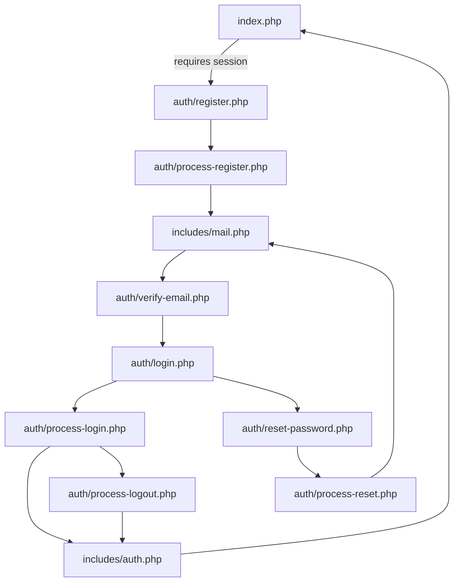

# Login Module

This project is a PHP/MySQL authentication module featuring secure registration, login, password reset, and email management. It includes both client-side and server-side validation, comprehensive audit logging, and rate limiting.

## Features

### 1. Authentication & Account Management

- **Registration:** Requires a unique username (min 6 chars, alphanumeric/underscore) and a strong password (min 8 chars, uppercase, lowercase, number, symbol). Accounts remain inactive until verified.
- **Login:** Supports credentials verification, account status checks, and a secure **"Remember Me"** persistent login via selector/validator token pairs. Session IDs are regenerated upon successful login.
- **Password Reset:** Token-based and time-limited. The request form uses neutral responses to prevent user enumeration.

### 2. Secure Email Change Flow

Triggered from the profile modal, this flow requires the _new email_ and _current password_:

- **Verification:** Sends a confirmation link (24h TTL, SHA-256 hashed token) to the _new_ address.
- **Activation:** Once confirmed, updates `users.email`, invalidates existing `remember_me` tokens, and removes pending requests.
- **Security:** Sends a security notification to the _old_ email address and rolls back database changes if SMTP delivery fails.

### 3. Rate Limiting & Audit Logs

To prevent abuse, actions are logged in `audit_logs` (`action`, `user_id`, `ip_address`, `meta`). The email change endpoint enforces the following limits per hour:

|Scope|Max Attempts / Hour|Action on Exceed|
|---|---|---|
|**Per Account**|5|Log `rate_limited_user` + Neutral Error|
|**Per IP Address**|20|Log `rate_limited_ip` + Neutral Error|

## Project Structure

``` text
├── assets/                          # Frontend Assets
│   ├── css/                         # UI Styling (navbar, page-transitions, startup-overlay)
|   ├── data/                        # Country list JSON for profile modal
|   ├── img/                         # background and other static images
│   └── js/                          # Client-side validations, profile modals, overlay logic
├── auth/                            # Authentication Handlers & Views
│   ├── login.php / process-login.php
│   ├── register.php / process-register.php
│   ├── reset-password.php / process-reset.php
│   ├── process-change-email.php / confirm-change-email.php
│   ├── verify-email.php / process-logout.php
├── database/                        # Database Schema & Diagrams
│   ├── schema.sql                   # MySQL Tables definition
│   └── db_diagram.pdf               # Visual DB Schema reference
├── includes/                        # Core Backend Modules
│   ├── auth.php                     # Session management, CSRF helpers, cookie handling
│   ├── db.php                       # Core PDO MySQL connection wrapper
│   ├── mail.php                     # SMTP mail wrappers (MailHog/Production)
│   ├── audit.php                    # System logging helpers
│   └── config.example.php / config.php
├── scripts/                         # Maintenance & CLI Utilities
│   ├── cleanup-expired-tokens.php   # Cron utility to purge expired database tokens
│   ├── cli-send-change-email-test.php
│   └── seed-test-user.php            # Create/update test user for local development
├── tests/                           # Automation Suite
│   └── auth-smoke.sh                # Zero-data HTTP routing & redirect smoke test
├── index.php                        # Protected landing dashboard (requires valid session)
└── start-dev.sh                     # Unified local startup script (App + MailHog)
```

## Requirements

Engine: PHP ≥ 8.0 (Required extensions: pdo_mysql, mbstring, openssl)
Database: MySQL 5.7+ / MariaDB equivalent
Mail Capture: MailHog (recommended for local development)

## Database Setup

Initialize your schema by importing database/schema.sql via your database client or terminal:

```bash
mysql -u root -p < database/schema.sql
```

## Test User

For local development, create a test user with known credentials:

```bash
php scripts/seed-test-user.php
```

Default test user credentials:

- **Username:** `utente`
- **Password:** `password123`
- **Email:** `utente@test.com`

This user will be automatically activated (`is_active = 1`) and can log in immediately.

## Configuration

Generate your local configuration file from the template:

```bash
cp includes/config.example.php includes/config.php
```

⚠️ Production Note: Ensure APP_ENV='prod' is declared in includes/config.php and configure an official, secure SMTP provider.

## Quick Start

From the project root, run:

```bash
bash start-dev.sh
```

Recommended workflow: use the single development script in the project root. It starts MailHog and the PHP built-in server together. The app will be available at <http://localhost:8000> and MailHog at <http://localhost:8025>.

Note: `start-dev.sh` does not run the token cleanup job; schedule `scripts/cleanup-expired-tokens.php` separately for maintenance.

## Application Flow

This project follows a simple end-to-end authentication flow where each page and handler has a clear role. The main steps are:



1. **Initial access**
   - `index.php` is the protected landing page.
   - It requires a valid session and redirects anonymous users to `auth/register.php`.

2. **Registration**
   - `auth/register.php` shows the registration form.
   - Client-side validation is handled by `assets/js/index.js`.
   - On submit, the form posts to `auth/process-register.php`.
   - The handler validates the data again on the server, checks for duplicates, hashes the password, creates the user, and generates an email verification token.
   - `includes/mail.php` sends the verification email.
   - The new account remains inactive until the verification link is opened.

3. **Email verification**
   - `auth/verify-email.php` receives the token from the email link.
   - It checks that the token is valid, unused, and not expired.
   - If everything is correct, the user account is activated and the verification token is marked as used.

4. **Login**
   - `auth/login.php` shows the login form and user feedback messages.
   - The form submits to `auth/process-login.php`.
   - The handler checks CSRF, loads the user from the database, verifies the password, handles failed login attempts, and creates the session.
   - If the `Remember me` option is selected, `includes/auth.php` issues a persistent token and restores the session on later visits.

5. **Password reset**
   - `auth/reset-password.php` shows two different states:
     - the reset request form, if no token is present;
     - the new password form, if a reset token is present.
   - The form submits to `auth/process-reset.php`.
   - The handler either sends a reset email or completes the password update, depending on the submitted data.
   - Reset tokens are time-limited and can be used only once.

6. **Logout**
   - `auth/process-logout.php` validates the request, clears the session, removes remember-me data, and redirects the user back to the public area.

7. **Shared support files**
   - `includes/auth.php` provides session handling, CSRF helpers, remember-me management, and logout utilities.
   - `includes/db.php` creates the database connection used by all handlers.
   - `includes/mail.php` sends verification and reset emails.

## Change Email (Account)

This project includes a secure "change email" flow available from the user's profile modal. Key points:

- The UI opens a top-level change-email dialog where the user provides the new email and their current password.
- The server handler `auth/process-change-email.php` verifies CSRF and re-authenticates the user, checks uniqueness of the new email, then creates an entry in `email_change_requests` with a hashed token and `expires_at` set to 24 hours.
- A verification email is sent to the new address containing a confirmation link handled by `auth/confirm-change-email.php`.
- When the confirmation link is opened and the token is valid and unused, the server updates `users.email`, marks the request as used (`used_at`), removes other pending change requests for the user, and invalidates remember-me tokens for that account.
- The system also sends a notification email to the old address to alert the user of the change.

Technical details:

- Table: `email_change_requests(user_id, new_email, token_hash, expires_at, used_at, created_at)` — token is stored hashed (SHA-256).
- Token TTL: 24 hours from creation.
- Mail sending: `includes/mail.php` provides `sendChangeEmailVerification()` and `sendChangeEmailNotice()` helpers. In development, MailHog is used (SMTP on `127.0.0.1:1025`, UI on `http://localhost:8025`).
- Security: token validation uses `hash_equals()` on the hashed token; handlers mark tokens as used to prevent replay.

## Rate limiting & Audit

To protect the change-email endpoint against abuse, the handler enforces two limits:

- Per-account: 5 `change_email_request` attempts per hour.
- Per-IP: 20 `change_email_request` attempts per hour.

When limits are exceeded the handler logs `rate_limited_user` or `rate_limited_ip` in `audit_logs` and returns a neutral error message. Audit entries are written to `audit_logs` with `action`, `user_id` (nullable), `ip_address`, `meta` (JSON) and `created_at` for diagnostic and security review.

Administrators can reset rate-limit entries by removing recent `audit_logs` rows (this project may add a small admin endpoint to clear blocks safely).

## Form Validations

### Register

Client-side and server-side checks are applied to:

- username is required
- username must be at least 6 characters
- username can contain only letters, numbers, and underscores
- email is required
- email must have a valid format
- password is required
- password must be at least 8 characters
- password must include at least one uppercase letter, one lowercase letter, one number, and one symbol
- confirm password is required
- confirm password must match password

### Login

Client-side and server-side checks are applied to:

- username is required
- password is required
- account status is checked on the server
- unverified accounts are rejected until the verification link is used
- invalid credentials are rejected
- repeated failed attempts can temporarily lock the account

The login form also supports persistent login with a `Remember me` checkbox:

- stores a secure selector/validator token pair in `remember_me_tokens`
- keeps only a hashed validator in the database
- restores the session automatically when the cookie is still valid
- clears the token on logout and when the cookie is not used

### Email Verification

Client-side and server-side checks are applied to:

- a verification token is generated during registration
- the verification link must be valid, unused, and not expired
- verified accounts are activated on the server before login

Registration keeps new accounts inactive and sends a verification email. The account is activated only after the verification link is opened, so unverified users cannot log in.

### Change Email

Client-side and server-side checks are applied to:

- email is required (client-side)
- email must have a valid format (client-side + server-side)
- the email must be different from the current email
- CSRF token is verified on submit (`validateCsrfToken()`)
- current password is required and verified with `password_verify()`
- new email uniqueness is checked against `users` (no duplicates)
- rate limits enforced: per-account (5/h) and per-IP (20/h) via `audit_logs`
- a verification token is generated, stored hashed (SHA-256) with 24h TTL, and emailed to the new address
- if SMTP sending fails the request is rolled back and an audit entry is written
- on confirmation (`auth/confirm-change-email.php`) the token is validated with `hash_equals()`, the request marked used, other pending requests removed, and `remember_me` tokens invalidated
- audit entries and notifications are created (old email is notified of changes)

### Password Reset Request

Client-side and server-side checks are applied to:

- email is required
- email must have a valid format
- if the email exists, a reset token is generated and sent
- the response remains neutral so the page does not reveal whether the account exists

### Password Reset

Client-side and server-side checks are applied to:

- reset token must be present
- new password is required
- new password must satisfy the strong-password policy
- new password must be different from the current password
- confirm password is required
- confirm password must match the new password
- token must be valid, unused, and not expired

## Database Checks

The server also checks data in the database before writing anything:

- duplicate username or email during registration
- stored password hash during login
- failed login attempts and lockout time
- account activation state
- password reset token hash
- password reset token expiration and usage

### Token Cleanup

Expired tokens are not removed automatically at the moment the user submits a form. Instead, a separate CLI maintenance task removes stale rows in the background to prevent user-facing performance drops.

The script deletes expired or already used rows from:

- `password_resets`
- `email_verifications`
- `remember_me_tokens`

To automate this cleanup (e.g., daily at 3:00 AM), add the following line to your server's crontab:

```Bash
0 3 * * * /usr/bin/php /absolute/path/to/your-project-root/scripts/cleanup-expired-tokens.php >/dev/null 2>&1
```

 💡 Note: Replace /absolute/path/to/your-project-root with the actual path to the project directory on your server.

## Security Notes

- CSRF tokens are used on all forms.
- Passwords are hashed with `password_hash()` and verified with `password_verify()`.
- Login regenerates the session ID after a successful authentication.
- New registrations stay inactive until the email verification link is opened.
- Password reset links are token-based and time-limited.
- The reset flow keeps the response neutral when requesting a reset email.
- Stale token rows are removed by the scheduled maintenance script described above.

## Auth Smoke Test

To verify routing, core authentication pages, and redirect behaviors without persisting test data, execute the test suite:

```bash
bash tests/auth-smoke.sh
```
